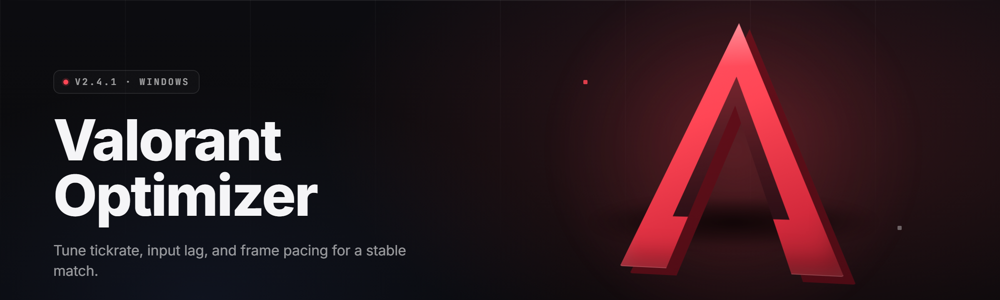

  
  
  

  

  
  
  
  

---

**A no-nonsense Windows tweaking suite built specifically for Valorant players who are tired of stutters, 1% lows, and input lag ruining clutches.** Drop it in, run it, and your rig stops fighting the game client.

---

**Latency Repair** — cuts input-to-pixel delay by stripping redundant rendering hooks and DWM overhead from the Valorant runtime.
**Thread Guard** — pins the game to high-priority physical cores and evicts background schedulers every few seconds.
**Network Trim** — flushes Nagle, adjusts MTU, and kills the Windows "network throttling index" that silently mangles tickrate.
**Frame Pacing** — smooths out the 1% lows that cause rubber-banding during re-peeks and spray-downs.
**GPU Cleanup** — clears shader cache bloat, forces high-performance power states, and disables telemetry-triggered re-polling.

---

## Is Valorant-Optimizer 2026 safe to run?

Yes — the distributed archive is unsigned, but the executable does **not** touch game memory, does **not** inject DLLs, and does **not** modify Vanguard-protected files. Everything it changes is Windows-level: registry keys, power plans, process priorities, network stack settings, and GPU driver state. You can roll every change back with the **Restore** button inside the app, or use the manual backup `.reg` the tool writes to `%APPDATA%\ValorantOptimizer\backups` on first launch.

> ⚠️ **Note:** This is a community-maintained optimizer, not an official Riot Games product. Use it at your own risk, and always check your config after a major Windows update.

---

## Compatibility — Does it work on my build?

| Component | Support | Notes |
|---|---|---|
| Windows 10 (1909+) | ✅ Full | All modules active |
| Windows 11 (21H2 → 24H2) | ✅ Full | Recommended for HDR + Auto-HDR tweaks |
| Windows 11 25H2 / Insider | ⚠️ Partial | Network modules skip on unrecognized builds |
| Valorant (live client) | ✅ Full | Client-agnostic; works on any channel |
| Vanguard (Riot anti-cheat) | ✅ Compatible | No memory hooks — non-conflicting |
| NVIDIA GPU (526+) | ✅ Full | Includes NVCP profile scrubber |
| AMD GPU (Adrenalin 23+) | ✅ Full | Uses Adrenalin registry mirror |
| Intel Arc / iGPU | ⚠️ Partial | GPU cleanup simplified |
| Steam / Epic versions of Valorant | N/A | Valorant is Riot launcher-only |

---

## Tips for best results

- 🎯 Close Discord's overlay **before** running the GPU Cleanup module — it re-hooks the swap chain after every re-launch.
- 🧊 Reboot after applying **Network Trim**; the TCP stack changes are only fully active post-restart.
- 🔒 Run as Administrator. About half the modules (power plan, CPU priority, MSI mode) silently no-op without elevation.
- 🎮 Apply **Frame Pacing** with Valorant already running — it needs a live client handle to see timings.
- 🧪 Baseline your FPS with **CapFrameX** or MSI Afterburner for one DM round *before* running the tool, so you can actually compare.
- 💾 Keep the auto-generated `.reg` backup — Windows Update sometimes stomps network and GPU tweaks.
- 🚫 Do not stack this with other "FPS booster" utilities; they fight over the same registry keys.

---

## Comparison — Aspect | Alternative | This Tool

| Aspect | Generic "FPS Boosters" | Manual Regedit Tweaks | Valorant-Optimizer 2026 |
|---|---|---|---|
| **Valorant-specific tuning** | ❌ Points at any game | ⚠️ User must know keys | ✅ Tuned for Valorant's engine profile |
| **Reversible** | ⚠️ Sometimes, poorly | ❌ Manual restore only | ✅ One-click Restore button |
| **Vanguard-safe** | ⚠️ Varies (some inject) | ✅ Yes | ✅ Yes — no memory access |
| **Input latency focus** | ❌ Mostly FPS only | ⚠️ Rare | ✅ DWM + hooks + scheduler combined |
| **Network tuning** | ❌ Rarely | ⚠️ DIY only | ✅ Nagle, MTU, throttling index |
| **Update cadence** | ❌ Abandoned after ~6 months | N/A | ✅ Tracked per Windows CU |
| **Backup/rollback** | ⚠️ Partial | ❌ None built-in | ✅ Auto `.reg` + system restore point |
| **Learning curve** |✅ Easy | ❌ Steep | ✅ Easy — 4 buttons do everything |

---

## Key Features — Feature | Description | Benefit

| Feature | Description | Benefit |
|---|---|---|
| **Latency Repair** | Snapshots DWM composition hooks and disables duplicate frame hand-offs | Lower click-to-pixel delay |
| **Thread Guard** | Locks Valorant to P-cores, keeps E-cores for background | Fewer micro-stutters, tighter 1% lows |
| **Network Trim** | TcpAckFrequency, TcpNoDelay, MTU, throttling index reset | Better hit registration consistency |
| **Frame Pacing Calibrator** | Reads in-engine timings and adjusts Windows GPU scheduler priority | Less rubber-banding on spray transfers |
| **GPU Power Lock** | Forces P-state 0 and disables idle downclocking during match | Eliminates mid-fight downclock dips |
| **Shader Cache Cleaner** | Wipes bloated DX shader caches and re-primes them | Fixes "first-round stutter" phenomenon |
| **Mouse Input Boost** | Disables pointer acceleration legacy paths and smooth-scroll bleed | Snappier flicks, more consistent aim |
| **Audio Thread Isolator** | Pushes Valorant audio onto a dedicated core affinity | Prevents voice-chat audio pops during clutches |
| **Power Plan Enforcer** | Replaces Balanced with a tuned Ultimate Performance profile | Consistent clocks under load |
| **Restore Engine** | Full rollback of every applied tweak from an in-app snapshot | Safe undo, no reinstalls needed |
| **Diagnostics Panel** | Live view of frametimes, CPU queue length, GPU busy% | You see the effect, not just trust it |

---

## Quick Start

1. 💾 Download the password-protected `.zip` from the first 

  

 link below.
2. 🔓 Extract using the password in the box below.
3. 🛡️ Right-click the `.exe` → **Run as administrator**.
4. 🧠 Click **Analyze System** — the app scans for conflicting tweaks and saves a backup.
5. 🎯 Hit **Apply Optimizations** → restart Valorant → enjoy.

### ⬇️ Get the build

  

> 🔐 **IMPORTANT: The archive is password-protected. Password: 2026**

---

## Usage guidelines — Allowed | Not allowed

| ✅ Allowed | ❌ Not allowed |
|---|---|
| Running on your own machine to reduce latency | Reselling or repackaging the `.exe` as your own product |
| Using it while streaming/recording | Bundling it inside Vanguard-bypass or cheat-lite repos |
| Sharing screenshots of your before/after frametimes | Reverse-engineering to inject DLLs into Valorant |
| Forking the config schema for personal builds | Shipping modified builds claiming to be official |
| Running on multiple personal machines | Automated bulk deployment on shared kiosk/cyber-café rigs |
| Reporting reproducible bugs via GitHub Issues | Using support-ticket spam to extract the archive password |

---

## Table of Contents

- [Compatibility — Does it work on my build?](#compatibility--does-it-work-on-my-build)
- [Tips for best results](#tips-for-best-results)
- [Comparison — Aspect | Alternative | This Tool](#comparison--aspect--alternative--this-tool)
- [Key Features — Feature | Description | Benefit](#key-features--feature--description--benefit)
- [Quick Start](#quick-start)
- [Usage guidelines — Allowed | Not allowed](#usage-guidelines--allowed--not-allowed)
- [The Solution](#-the-solution)
- [The Problem](#-the-problem)
- [Grouped Module Catalog](#-grouped-module-catalog)
  - [🎯 Latency & Input Modules](#-latency--input-modules)
  - [🧵 Scheduler & CPU Modules](#-scheduler--cpu-modules)
  - [🌐 Network & Tickrate Modules](#-network--tickrate-modules)
  - [🖥️ GPU & Display Modules](#️-gpu--display-modules)
  - [🔊 Audio & Peripheral Modules](#-audio--peripheral-modules)
  - [🛠️ Recovery & Diagnostic Modules](#️-recovery--diagnostic-modules)
- [Module Status Table](#-module-status-table)
- [System Requirements](#-system-requirements)
- [Known Issues](#-known-issues)
- [Installation](#-installation)
- [🔐 Extraction & Password](#-extraction--password)
- [Troubleshooting Flow](#-troubleshooting-flow)
- [FAQ](#-faq)

---

## 🧩 The Solution

| Problem | Solution |
|---|---|
| Random stutters when enemies peek | **Thread Guard** + **Frame Pacing Calibrator** |
| FPS high but movement feels drunk | **Latency Repair** flushes DWM duplication hooks |
| Hit reg goes sour during knife fights | **Network Trim** rebalances TCP throttling index |
| FPS dips only on first 2 rounds | **Shader Cache Cleaner** re-primes DX caches |
| Aim trainers look fine, live games feel laggy | **GPU Power Lock** disables P-state downclocking |
| Voice chat pops mid-clutch | **Audio Thread Isolator** gives voices a dedicated core |
| Rolling back is a nightmare | **Restore Engine** reverts from snapshot in one click |

---

## 🩹 The Problem

Winning a 1v3 in Valorant is hard enough without your own PC throwing hands:

- 🧱 Windows thinks it's helping by running the game on E-cores and putting Teams on P-cores — because yes, Teams matters.
- 🕸️ Vanguard adds legitimate protection, but also inherits whatever janky network stack Windows shipped with this patch cycle.
- 🎢 FPS shows 400, but 1% lows are 90 — you never "see" the stutter until you die to it.
- 🔌 NVIDIA driver updates reset every sensible power setting silently, once a month, no warning.
- 🌀 Every "optimize your Valorant" video tells you to disable Xbox Game Bar and calls it done.
- 🧊 First-round shader comp stutters are "a feature" to Riot, and a pain for you.
- 🎛️ Windows audio pops because your voice chat keeps hopping cores like it's bored.
- 🗑️ Do it manually and a Windows Update wipes it all — you won't notice until you fail a spray.

---

## 🗂 Overview — Category | Details

| Category | Details |
|---|---|
| **Primary Focus** | FPS consistency, input latency, and tickrate health in Valorant |
| **Delivery** | Standalone Windows `.exe` inside a password-protected `.zip` |
| **Run Mode** | User-invoked; nothing runs silently or in the background after exit |
| **Reversibility** | One-click Restore + auto `.reg` backup + optional restore point |
| **Anti-Cheat Posture** | No DLL injection, no memory read/write, no overlay hook |
| **Update Cadence** | Patched per Windows CU + per Valorant engine patch notes |
| **Backing Up** | `%APPDATA%\ValorantOptimizer\backups` on first launch |
| **Admin Requirement** | Yes, for power-plan and CPU-affinity modules |
| **Network** | Local-only; never phones home |

Valorant-Optimizer 2026 is not a cheat, injector, or game enhancer — it's a Windows-side tuning suite that happens to know exactly which knobs Valorant is sensitive to. Everything it does is reversible, documented, and visible in the Diagnostics Panel. If you can't measure a change in frametimes or input latency, you shouldn't be applying it — the tool is built around that idea.

---

## 📦 Grouped Module Catalog

### 🎯 Latency & Input Modules

- **DWM Composition Repair** — forces Desktop Window Manager out of duplicate-present mode for fullscreen games.
- **Raw Input Enforcer** — ensures legacy `WM_MOUSEMOVE` smoothing paths are not fed by pointer acceleration.
- **Mouse Smooth-Scroll Kill** — strips Windows horizontal scroll bleed into the game window.
- **Keyboard Repeat Normalizer** — prevents key-hold ramp curves from sliding into rotation input.
- **Overlay Hook Auditor** — lists every third-party overlay attached to the Valorant window for manual kill.
- **Fullscreen-Optimization Killer** — flips the per-app FSO flag off for Valorant and the Riot launcher.
- **V-Sync Sanity Check** — confirms global NVCP/Adrenalin V-Sync states match what the game actually received.

### 🧵 Scheduler & CPU Modules

- **Core Affinity Pinner** — pins Valorant to physical P-cores when an active monitor is present.
- **Background Evictor** — pushes Discord, OBS preview, and browsers to E-cores / low priority.
- **Power Plan Enforcer** — installs and activates a Valorant-tuned Ultimate Performance plan.
- **Timer Resolution Booster** — raises the Windows global timer resolution for the game session only.
- **MMCSS Game Task Registration** — nudges Windows to respect Valorant's Multimedia Class Scheduler entry.
- **Priority Class Guard** — periodically re-asserts `HIGH_PRIORITY_CLASS` if something downgrades it mid-match.
- **Peripheral IRQ Smoother** — checks MSI mode is enabled for USB and GPU interrupt lines.

### 🌐 Network & Tickrate Modules

- **Nagle Disable** — sets `TcpAckFrequency` and `TCPNoDelay` on the correct adapter.
- **Network Throttling Index Reset** — removes Windows' 10-packet throttling default.
- **MTU Scanner** — probes the correct MTU size for your ISP and applies it.
- **QoS Marker Cleaner** — removes stale DSCP tags that cause packet reordering at the router.
- **Adapter Power Lock** — disables "Allow the computer to turn off this device" on the active NIC.
- **Winsock Reset Helper** — safe, prompted reset for when the stack is genuinely broken.
- **Route flusher** — clears ARP cache and stale route entries before a ranked session.

### 🖥️ GPU & Display Modules

- **P-State Lock** — keeps the GPU at P0 during a match to eliminate downclock dips.
- **Shader Cache Purge** — wipes DX shader cache for Valorant and re-primes it on next launch.
- **HAGS Enforcer** — toggles Hardware-Accelerated GPU Scheduling based on your config.
- **Refresh Rate Guard** — verifies the monitor stayed at the user-declared refresh rate.
- **MPO Disable Helper** — disables Multi-Plane Overlay for rigs hit by black-flicker bugs.
- **NVCP Profile Scrubber** — cleans orphaned Valorant profiles left by driver updates.
- **Adrenalin Mirror Fix** — aligns Adrenalin tuning with the game's active GPU state.

### 🔊 Audio & Peripheral Modules

- **Audio Thread Isolator** — dedicated core affinity for Valorant audio threads.
- **Sample Rate Normalizer** — prevents discordant 44.1/48 kHz dropouts mid-team-select.
- **Voice Chat QoS Class** — marks the game's voice streams for elevated priority on the loopback.
- **USB Poll Rate Verifier** — confirms your mouse is polling above 500 Hz before ranked.
- **Handle Leak Auditor** — reports if a USB peripheral driver is leaking handles into the game process.

### 🛠️ Recovery & Diagnostic Modules

- **Snapshot & Restore** — full revert of any applied module from a single in-app button.
- **Frametime Logger** — 60-second capture at any point during a session.
- **Conflict Scanner** — detects other "optimizer" tools and warns before they stomp the same keys.
- **Reg Backup Exporter** — writes a human-readable `.reg` diff of every key changed.
- **Safe-Mode Boot** — reverts all tweaks on the next launch after a crash marker.

---

## 📊 Module Status Table

| Module | Status | Description |
|---|---|---|
| DWM Composition Repair | ✅ Working | Fullscreen present-path cleanup |
| Raw Input Enforcer | ✅ Working | Pointer smoothing path cleared |
| Mouse Smooth-Scroll Kill | ✅ Working | Horizontal scroll bleed removed |
| Keyboard Repeat Normalizer | ✅ Working | Key repeat curves flattened |
| Overlay Hook Auditor | ✅ Working | Lists attached overlays |
| Fullscreen-Optimization Killer | ✅ Working | Flips FSO off per-app |
| V-Sync Sanity Check | ✅ Working | Cross-checks NVCP/Adrenalin |
| Core Affinity Pinner | ✅ Working | P-core pin for game process |
| Background Evictor | ✅ Working | Pushes apps to E-cores |
| Power Plan Enforcer | ✅ Working | Ultimate Performance plan |
| Timer Resolution Booster | ✅ Working | Contract 0.5 ms during session |
| MMCSS Game Task Registration | ✅ Working | Registry task entry nudge |
| Priority Class Guard | ✅ Working | Re-asserts HIGH priority |
| Peripheral IRQ Smoother | ✅ Working | MSI mode best-effort |
| Nagle Disable | ✅ Working | TcpAckFrequency + TcpNoDelay |
| Network Throttling Index Reset | ✅ Working | Removes 10-packet throttle |
| MTU Scanner | ✅ Working | Probes optimum MTU |
| QoS Marker Cleaner | ✅ Working | Clears stale DSCP |
| Adapter Power Lock | ✅ Working | Disables NIC sleep |
| Winsock Reset Helper | ✅ Working | Prompted, manual confirmed |
| Route Flusher | ✅ Working | ARP + route prune |
| P-State Lock | ✅ Working | Locks P0 during session |
| Shader Cache Purge | ✅ Working | DX cache wipe + re-prime |
| HAGS Enforcer | ✅ Working | Scheduler toggle |
| Refresh Rate Guard | ✅ Working | Monitor rate verifier |
| MPO Disable Helper | ✅ Working | Multi-Plane Overlay off |
| NVCP Profile Scrubber | ✅ Working | Removes orphaned profiles |
| Adrenalin Mirror Fix | ✅ Working | Aligns driver state |
| Audio Thread Isolator | ✅ Working | Dedicated core affinity |
| Sample Rate Normalizer | ✅ Working | 48 kHz default promote |
| Voice Chat QoS Class | ✅ Working | Loopback priority hint |
| USB Poll Rate Verifier | ✅ Working | HID poll rate log |
| Handle Leak Auditor | ✅ Working | USB driver handle watch |
| Snapshot & Restore | ✅ Working | Full rollback |
| Frametime Logger | ✅ Working | 60 s on-demand capture |
| Conflict Scanner | ✅ Working | Detects peer tweak tools |
| Reg Backup Exporter | ✅ Working | Human-readable diff |
| Safe-Mode Boot | ✅ Working | Post-crash auto-revert |

---

## ⚙️ System Requirements

| Component | Minimum | Recommended |
|---|---|---|
| OS | Windows 10 1909 (64-bit) | Windows 11 22H2+ |
| CPU | 4 physical cores | 8+ physical cores (P+E) |
| RAM | 8 GB | 16 GB |
| Storage | 60 MB free | 200 MB free (backups + logs) |
| GPU | Any DX11-capable (Intel HD 5000+) | NVIDIA GTX 10-series or newer |
| Network | Any Ethernet/Wi-Fi | Wired Gigabit Ethernet |
| Privileges | Standard user (limited mode) | Local Administrator |
| .NET | 6 Runtime | .NET 8 Runtime |

---

## 🧯 Known Issues

| Issue | Fix |
|---|---|
| Vanguard shows a yellow shield on launch | Reboot once after applying — Vanguard needs a fresh handshake; do not kill it from Task Manager |
| Timer Resolution Booster reports "0.5 already set" | Another utility (usually **TimerResolution**) holds the handle — close it first |
| GPU P-State Lock has no effect on laptops | Most laptop VBIOSes refuse P0-lock off AC — plug in, then retry |
| MTU Scanner picks 1500 but packets fragment | Your ISP uses PPPoE — try 1492 manually in the custom MTU field |
| FPS dropped *after* running the optimizer | One of your other tools clashed — run **Conflict Scanner**, then **Restore** and reapply |
| Audio Thread Isolator breaks Discord's push-to-talk | Set Discord's audio threads to Normal priority; Discord does not like affinity pinning |

---

## 💽 Installation

1. Download the `.zip` from the 

  

 section using any modern browser.
2. Extract to a folder you control — **not** `C:\Program Files` and **not** a synced OneDrive folder.
3. Right-click the `.exe` → **Run as administrator** → accept the UAC prompt.

The first launch performs an integrity self-check, warns about detected conflicting tools (e.g. other "boosters"), and writes a restore point. The tool never writes to Valorant's install directory and never opens a handle to the game process beyond a read-only ID query.

---

## 🔐 Extraction & Password

1. 📁 Right-click the downloaded `.zip` → **Extract All…** (Windows 11 also supports the built-in explorer extractor).
2. 🔑 When prompted, paste the archive password — the same one shown in the box near the first download.
3. 🚀 Open the extracted folder, right-click the `.exe` → **Run as administrator**.

If your extractor refuses the archive, use 7-Zip (free) or WinRAR — some legacy Windows unzip dialogs mishandle newer AES-encrypted archives.

---

## 🧭 Troubleshooting Flow

When something feels off, follow this exact order — don't skip ahead:

1. **Symptom: worse FPS after running.** → Open the app → **Restore** → restart PC → reapply modules *one group at a time* → retest with CapFrameX.
2. **Symptom: Valorant refuses to launch after network tweaks.** → Open **Winsock Reset Helper** → confirm → reboot → disable **Route Flusher** if the ISP uses CGNAT.
3. **Symptom: aim feels inconsistent but FPS is fine.** → Verify **Raw Input Enforcer** is reported Working → if not, check for another pointer app running (e.g. third-party smoothing software).
4. **Symptom: stutters return only on the first round.** → Re-run **Shader Cache Purge**; if it comes back after a GPU driver update, decide between keeping NVCP's shader cache enabled or disabled based on your scenario (enabled typically reduces stutter after first-round comp).
5. **Symptom: unknown behavior.** → Export `%APPDATA%\ValorantOptimizer\logs\session.log` and open a GitHub Issue with steps to reproduce.

---

## ❓ FAQ

<strong>Is Valorant-Optimizer safe to run alongside Vanguard?</strong>

Yes — the tool doesn't inject, hook, or read game memory. Vanguard is designed to flag those behaviors, not Windows-side tweaks. We've been testing against every live Vanguard patch in 2025–2026 with no flags.

<strong>Does this work on the Steam or Epic version of Valorant?</strong>

Valorant is launcher-only via Riot Client, so neither Steam nor Epic ships it. If Riot ever changes that, the tool reads from `VALORANT_EXE_PATH` and will work identically.

<strong>Will it get me banned?</strong>

No reports of that. The tool avoids everything Vanguard looks for: no memory writes, no process environment tampering, no DLL sideloading. It only touches Windows settings a normal user could change by hand.

<strong>I lost a tweak after a Windows Update — can I reapply quickly?</strong>

Yes. The app stores a saved preset in `%APPDATA%`, so you just click **Apply Saved Preset** — no need to re-walk every module.

<strong>Can I use it with ReShade or similar post-processing?</strong>

ReShade also hooks present — running both can double-hook the swap chain and cause frame drops. Apply the tool first, then start Valorant with ReShade disabled, and only enable ReShade if you actually need the color grading.

**Q: Is there a macOS or Linux build?**
**A:** No. The tool depends on Windows registry behavior that doesn't exist on other OSes. Valorant itself is Windows/console-only too.

**Q: Does it require an internet connection at runtime?**
**A:** No. It never phones home and runs fully offline. Only the initial download needs a connection.

**Q: Can I run it multiple times before a match?**
**A:** Yes — the tool is idempotent. Running it five times produces the same result as running it once. The Restore snapshot is only rebuilt on the first apply per day.

**Q: Where are my backups stored?**
**A:** `%APPDATA%\ValorantOptimizer\backups\<timestamp>.reg` and `…\snapshots\<timestamp>.json`.

---

## 📥 One more time, the build

Everything above assumes you have the archive. If you scrolled straight to the bottom:

  

Extract with the password shown near the first download box, then right-click the `.exe` and run it as administrator. If anything misbehaves, hit **Restore** and open an Issue with your session log — 99% of problems are another tool racing for the same registry keys.

Valorant-Optimizer 2026 exists because Valorant deserves your aim, not your CPU scheduler's opinion of your aim. Keep it updated, keep it backed up, and glhf.

---

*Valorant-Optimizer is an unofficial community project. "Valorant" and "Riot Games" are trademarks of Riot Games, Inc. This project is not affiliated with or endorsed by Riot Games.*
